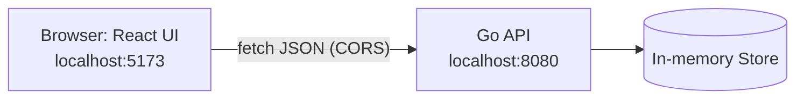

# Tutorial: Build a Todo App with Go and React

In this tutorial you will build, from an empty folder, a to-do app made of two separate programs:

- a **REST API** written in Go (standard library only, data kept in memory)
- a **web UI** written in React, built and served by Vite

Time needed: about 60-90 minutes. No prior Go or React experience is assumed, but basic programming knowledge is.



## What you will learn

- Structuring a small Go program into files (`main`, `store`, `handlers`)
- Writing a concurrency-safe in-memory store with `sync.RWMutex`
- Building REST endpoints with the Go 1.22 `net/http` router
- Testing HTTP handlers with `httptest`
- Enabling CORS so a separate UI can call your API
- Building a React UI with hooks (`useState`, `useEffect`) and `fetch`

## Prerequisites

| Tool    | Version | Check with       |
|---------|---------|------------------|
| Go      | 1.22+   | `go version`     |
| Node.js | 18+     | `node --version` |
| npm     | 9+      | `npm --version`  |

Go 1.22 is required because the router patterns used below (`GET /api/todos/{id}`) were added in that release.

Commands are shown for PowerShell on Windows. They also work in bash/zsh unless noted.

---

## Part 1: The Go backend

### Step 1.1: Create the project

```powershell
mkdir todo-app
cd todo-app
mkdir backend
cd backend
go mod init todo-api
```

`go mod init` creates `go.mod`. Open it and make sure the `go` line says `1.22` or higher:

```
module todo-api

go 1.22
```

> The `go` line in `go.mod` decides which language/library features are enabled. With an older value the new router patterns would not work.

### Step 1.2: The data model and store

Create `store.go`. This file knows nothing about HTTP; it only manages todos.

```go
package main

import (
	"errors"
	"sort"
	"sync"
	"time"
)

// Todo is a single to-do item.
type Todo struct {
	ID        int       `json:"id"`
	Title     string    `json:"title"`
	Done      bool      `json:"done"`
	CreatedAt time.Time `json:"createdAt"`
}

var ErrNotFound = errors.New("todo not found")

// Store is an in-memory, concurrency-safe todo store.
// Data is lost when the process exits (by design, for learning purposes).
type Store struct {
	mu     sync.RWMutex
	nextID int
	todos  map[int]Todo
}

func NewStore() *Store {
	return &Store{nextID: 1, todos: make(map[int]Todo)}
}

func (s *Store) List() []Todo {
	s.mu.RLock()
	defer s.mu.RUnlock()
	out := make([]Todo, 0, len(s.todos))
	for _, t := range s.todos {
		out = append(out, t)
	}
	sort.Slice(out, func(i, j int) bool { return out[i].ID < out[j].ID })
	return out
}

func (s *Store) Get(id int) (Todo, error) {
	s.mu.RLock()
	defer s.mu.RUnlock()
	t, ok := s.todos[id]
	if !ok {
		return Todo{}, ErrNotFound
	}
	return t, nil
}

func (s *Store) Create(title string) Todo {
	s.mu.Lock()
	defer s.mu.Unlock()
	t := Todo{ID: s.nextID, Title: title, CreatedAt: time.Now().UTC()}
	s.todos[t.ID] = t
	s.nextID++
	return t
}

func (s *Store) Update(id int, title string, done bool) (Todo, error) {
	s.mu.Lock()
	defer s.mu.Unlock()
	t, ok := s.todos[id]
	if !ok {
		return Todo{}, ErrNotFound
	}
	t.Title = title
	t.Done = done
	s.todos[id] = t
	return t, nil
}

func (s *Store) Delete(id int) error {
	s.mu.Lock()
	defer s.mu.Unlock()
	if _, ok := s.todos[id]; !ok {
		return ErrNotFound
	}
	delete(s.todos, id)
	return nil
}
```

Things worth understanding:

- **Struct tags** such as `` `json:"createdAt"` `` control the field names in JSON output.
- **`sync.RWMutex`**: Go's HTTP server handles each request in its own goroutine, so several requests can touch the map at once. Concurrent map writes crash a Go program, so every access is guarded. Many readers may hold `RLock` together; a writer takes `Lock` exclusively.
- **`defer`** runs the unlock when the function returns, even on early returns.
- **Map iteration order is random** in Go, so `List` sorts by ID to give the UI a stable order.
- **`ErrNotFound`** is a sentinel error. The HTTP layer will translate it into a `404`.

### Step 1.3: The HTTP handlers

Create `handlers.go`:

```go
package main

import (
	"encoding/json"
	"errors"
	"net/http"
	"strconv"
	"strings"
)

type todoInput struct {
	Title string `json:"title"`
	Done  bool   `json:"done"`
}

// NewRouter wires up the REST routes (Go 1.22+ method/path patterns).
func NewRouter(s *Store, allowedOrigin string) http.Handler {
	mux := http.NewServeMux()
	h := &handlers{store: s}

	mux.HandleFunc("GET /api/todos", h.list)
	mux.HandleFunc("POST /api/todos", h.create)
	mux.HandleFunc("GET /api/todos/{id}", h.get)
	mux.HandleFunc("PUT /api/todos/{id}", h.update)
	mux.HandleFunc("DELETE /api/todos/{id}", h.delete)

	return cors(allowedOrigin, mux)
}

type handlers struct{ store *Store }

func (h *handlers) list(w http.ResponseWriter, r *http.Request) {
	writeJSON(w, http.StatusOK, h.store.List())
}

func (h *handlers) get(w http.ResponseWriter, r *http.Request) {
	id, ok := parseID(w, r)
	if !ok {
		return
	}
	t, err := h.store.Get(id)
	if err != nil {
		writeStoreError(w, err)
		return
	}
	writeJSON(w, http.StatusOK, t)
}

func (h *handlers) create(w http.ResponseWriter, r *http.Request) {
	in, ok := decodeInput(w, r)
	if !ok {
		return
	}
	writeJSON(w, http.StatusCreated, h.store.Create(in.Title))
}

func (h *handlers) update(w http.ResponseWriter, r *http.Request) {
	id, ok := parseID(w, r)
	if !ok {
		return
	}
	in, ok := decodeInput(w, r)
	if !ok {
		return
	}
	t, err := h.store.Update(id, in.Title, in.Done)
	if err != nil {
		writeStoreError(w, err)
		return
	}
	writeJSON(w, http.StatusOK, t)
}

func (h *handlers) delete(w http.ResponseWriter, r *http.Request) {
	id, ok := parseID(w, r)
	if !ok {
		return
	}
	if err := h.store.Delete(id); err != nil {
		writeStoreError(w, err)
		return
	}
	w.WriteHeader(http.StatusNoContent)
}

// --- helpers ---

func parseID(w http.ResponseWriter, r *http.Request) (int, bool) {
	id, err := strconv.Atoi(r.PathValue("id"))
	if err != nil {
		writeError(w, http.StatusBadRequest, "invalid id")
		return 0, false
	}
	return id, true
}

func decodeInput(w http.ResponseWriter, r *http.Request) (todoInput, bool) {
	var in todoInput
	r.Body = http.MaxBytesReader(w, r.Body, 1<<20)
	if err := json.NewDecoder(r.Body).Decode(&in); err != nil {
		writeError(w, http.StatusBadRequest, "invalid JSON body")
		return in, false
	}
	in.Title = strings.TrimSpace(in.Title)
	if in.Title == "" {
		writeError(w, http.StatusBadRequest, "title is required")
		return in, false
	}
	return in, true
}

func writeStoreError(w http.ResponseWriter, err error) {
	if errors.Is(err, ErrNotFound) {
		writeError(w, http.StatusNotFound, err.Error())
		return
	}
	writeError(w, http.StatusInternalServerError, "internal error")
}

func writeError(w http.ResponseWriter, status int, msg string) {
	writeJSON(w, status, map[string]string{"error": msg})
}

func writeJSON(w http.ResponseWriter, status int, v any) {
	w.Header().Set("Content-Type", "application/json")
	w.WriteHeader(status)
	_ = json.NewEncoder(w).Encode(v)
}

// cors allows the separately-served UI to call the API from the browser.
func cors(origin string, next http.Handler) http.Handler {
	return http.HandlerFunc(func(w http.ResponseWriter, r *http.Request) {
		w.Header().Set("Access-Control-Allow-Origin", origin)
		w.Header().Set("Access-Control-Allow-Methods", "GET, POST, PUT, DELETE, OPTIONS")
		w.Header().Set("Access-Control-Allow-Headers", "Content-Type")
		if r.Method == http.MethodOptions {
			w.WriteHeader(http.StatusNoContent)
			return
		}
		next.ServeHTTP(w, r)
	})
}
```

How it works:

- **Routing.** `"GET /api/todos/{id}"` matches only GET requests, and `{id}` is read with `r.PathValue("id")`. A request with the wrong method on a known path gets `405` automatically.
- **Handlers as methods.** `handlers` holds a reference to the `Store`, so every handler can reach it without global variables.
- **Validation lives in one place** (`decodeInput`): it limits the body to 1 MiB, rejects malformed JSON, and trims and requires the title. Both `create` and `update` reuse it.
- **Status codes** follow REST conventions: `201` for create, `204` for a delete with no body, `400` for bad input, `404` for unknown IDs.
- **Middleware.** `cors` wraps the router: it takes an `http.Handler` and returns another one. Browsers block a page on `localhost:5173` from calling `localhost:8080` unless the API opts in via these headers. For non-simple requests (here, JSON `PUT`/`POST`/`DELETE`) the browser first sends an `OPTIONS` "preflight" request, which the middleware answers with `204` without reaching the router.

### Step 1.4: The entry point

Create `main.go`:

```go
package main

import (
	"log"
	"net/http"
	"os"
)

func main() {
	addr := getenv("ADDR", ":8080")
	origin := getenv("ALLOWED_ORIGIN", "http://localhost:5173")

	log.Printf("todo-api listening on %s (CORS origin: %s)", addr, origin)
	log.Fatal(http.ListenAndServe(addr, NewRouter(NewStore(), origin)))
}

func getenv(key, fallback string) string {
	if v := os.Getenv(key); v != "" {
		return v
	}
	return fallback
}
```

Configuration comes from environment variables with sensible defaults, so you can change the port or allowed origin without editing code.

### Step 1.5: Try the API

Start the server:

```powershell
go run .
```

In a **second terminal**, exercise it:

```powershell
# Create
Invoke-RestMethod -Method Post -Uri http://localhost:8080/api/todos `
  -ContentType "application/json" -Body '{"title":"learn Go"}'

# List
Invoke-RestMethod http://localhost:8080/api/todos

# Mark done
Invoke-RestMethod -Method Put -Uri http://localhost:8080/api/todos/1 `
  -ContentType "application/json" -Body '{"title":"learn Go","done":true}'

# Delete
Invoke-RestMethod -Method Delete -Uri http://localhost:8080/api/todos/1
```

On macOS/Linux, or with `curl.exe` on Windows (plain `curl` in Windows PowerShell 5.1 is an alias for something else):

```bash
curl -X POST http://localhost:8080/api/todos -H "Content-Type: application/json" -d '{"title":"learn Go"}'
curl http://localhost:8080/api/todos
```

Try breaking it on purpose and check the responses: an empty title (`400`), `GET /api/todos/abc` (`400`), `GET /api/todos/99` (`404`). Stop the server with `Ctrl+C` when you are done.

### Step 1.6: Write tests

Create `handlers_test.go`:

```go
package main

import (
	"encoding/json"
	"net/http"
	"net/http/httptest"
	"strings"
	"testing"
)

func do(t *testing.T, h http.Handler, method, path, body string) *httptest.ResponseRecorder {
	t.Helper()
	req := httptest.NewRequest(method, path, strings.NewReader(body))
	rec := httptest.NewRecorder()
	h.ServeHTTP(rec, req)
	return rec
}

func TestTodoLifecycle(t *testing.T) {
	h := NewRouter(NewStore(), "*")

	// create
	rec := do(t, h, "POST", "/api/todos", `{"title":"  learn Go "}`)
	if rec.Code != http.StatusCreated {
		t.Fatalf("create: got %d", rec.Code)
	}
	var created Todo
	_ = json.Unmarshal(rec.Body.Bytes(), &created)
	if created.ID != 1 || created.Title != "learn Go" || created.Done {
		t.Fatalf("unexpected todo: %+v", created)
	}

	// list
	rec = do(t, h, "GET", "/api/todos", "")
	var list []Todo
	_ = json.Unmarshal(rec.Body.Bytes(), &list)
	if rec.Code != http.StatusOK || len(list) != 1 {
		t.Fatalf("list: code=%d len=%d", rec.Code, len(list))
	}

	// update
	rec = do(t, h, "PUT", "/api/todos/1", `{"title":"learn Go","done":true}`)
	var updated Todo
	_ = json.Unmarshal(rec.Body.Bytes(), &updated)
	if rec.Code != http.StatusOK || !updated.Done {
		t.Fatalf("update: code=%d todo=%+v", rec.Code, updated)
	}

	// delete, then 404
	if rec = do(t, h, "DELETE", "/api/todos/1", ""); rec.Code != http.StatusNoContent {
		t.Fatalf("delete: got %d", rec.Code)
	}
	if rec = do(t, h, "GET", "/api/todos/1", ""); rec.Code != http.StatusNotFound {
		t.Fatalf("get after delete: got %d", rec.Code)
	}
}

func TestValidation(t *testing.T) {
	h := NewRouter(NewStore(), "*")

	cases := []struct {
		name, method, path, body string
		want                     int
	}{
		{"empty title", "POST", "/api/todos", `{"title":"   "}`, 400},
		{"bad json", "POST", "/api/todos", `{`, 400},
		{"bad id", "GET", "/api/todos/abc", "", 400},
		{"update missing", "PUT", "/api/todos/99", `{"title":"x"}`, 404},
		{"delete missing", "DELETE", "/api/todos/99", "", 404},
	}
	for _, c := range cases {
		if rec := do(t, h, c.method, c.path, c.body); rec.Code != c.want {
			t.Errorf("%s: got %d, want %d", c.name, rec.Code, c.want)
		}
	}
}

func TestCORSPreflight(t *testing.T) {
	h := NewRouter(NewStore(), "http://localhost:5173")
	rec := do(t, h, "OPTIONS", "/api/todos", "")
	if rec.Code != http.StatusNoContent ||
		rec.Header().Get("Access-Control-Allow-Origin") != "http://localhost:5173" {
		t.Fatalf("preflight: code=%d headers=%v", rec.Code, rec.Header())
	}
}
```

Run them:

```powershell
go vet ./...
go test ./...
```

Expected output: `ok  	todo-api	...`

Why this approach works: `httptest.NewRecorder` stands in for a real connection, so handlers are tested in-process, with no port and no network. `TestValidation` is a **table-driven test**, the usual Go idiom: add a row to cover a new case.

> **Checkpoint.** You now have a complete, tested API. Everything from here on is the UI.

---

## Part 2: The React frontend

### Step 2.1: Create the project

From the `todo-app` folder:

```powershell
cd ..
mkdir frontend
cd frontend
mkdir src
```

Create `package.json`:

```json
{
  "name": "todo-ui",
  "private": true,
  "version": "0.1.0",
  "type": "module",
  "scripts": {
    "dev": "vite",
    "build": "vite build",
    "preview": "vite preview"
  },
  "dependencies": {
    "react": "^18.3.1",
    "react-dom": "^18.3.1"
  },
  "devDependencies": {
    "@vitejs/plugin-react": "^4.3.4",
    "vite": "^5.4.11"
  }
}
```

Install the dependencies:

```powershell
npm install
```

> You can instead scaffold with `npm create vite@latest` (choose React). This tutorial writes the few files by hand so you can see that nothing is hidden.

Create `vite.config.js`:

```js
import { defineConfig } from "vite";
import react from "@vitejs/plugin-react";

export default defineConfig({
  plugins: [react()],
  server: { port: 5173 },
});
```

Create `index.html` (Vite uses this as the entry page):

```html
<!doctype html>
<html lang="en">
  <head>
    <meta charset="UTF-8" />
    <meta name="viewport" content="width=device-width, initial-scale=1.0" />
    <title>Todo</title>
  </head>
  <body>
    <div id="root"></div>
    <script type="module" src="/src/main.jsx"></script>
  </body>
</html>
```

Create `.env.example` (documents the one setting the UI has; copy it to `.env` only if your API is not on port 8080):

```
VITE_API_URL=http://localhost:8080
```

### Step 2.2: Bootstrap React

Create `src/main.jsx`:

```jsx
import React from "react";
import { createRoot } from "react-dom/client";
import App from "./App.jsx";
import "./styles.css";

createRoot(document.getElementById("root")).render(
  <React.StrictMode>
    <App />
  </React.StrictMode>
);
```

This mounts the `App` component into the `<div id="root">`. `StrictMode` runs some effects twice in development to help catch bugs; it is harmless in production builds.

### Step 2.3: The API client

Keep all HTTP code in one file so components never build URLs by hand. Create `src/api.js`:

```js
const BASE = import.meta.env.VITE_API_URL ?? "http://localhost:8080";

async function request(path, options = {}) {
  const res = await fetch(`${BASE}${path}`, {
    headers: { "Content-Type": "application/json" },
    ...options,
  });
  if (!res.ok) {
    let message = `Request failed (${res.status})`;
    try {
      message = (await res.json()).error ?? message;
    } catch {
      /* body was not JSON */
    }
    throw new Error(message);
  }
  return res.status === 204 ? null : res.json();
}

export const listTodos = () => request("/api/todos");

export const createTodo = (title) =>
  request("/api/todos", { method: "POST", body: JSON.stringify({ title }) });

export const updateTodo = (todo) =>
  request(`/api/todos/${todo.id}`, {
    method: "PUT",
    body: JSON.stringify({ title: todo.title, done: todo.done }),
  });

export const deleteTodo = (id) => request(`/api/todos/${id}`, { method: "DELETE" });
```

Key points:

- `import.meta.env.VITE_API_URL` is how Vite exposes variables that start with `VITE_`.
- `fetch` does **not** reject on HTTP errors like 400 or 404, so `request` checks `res.ok` and throws an `Error` carrying the `{"error": "..."}` message from the Go API.
- A `204 No Content` response has no body, so it returns `null` instead of calling `res.json()`.

### Step 2.4: The App component

Create `src/App.jsx`:

```jsx
import { useEffect, useState } from "react";
import { listTodos, createTodo, updateTodo, deleteTodo } from "./api.js";

export default function App() {
  const [todos, setTodos] = useState([]);
  const [title, setTitle] = useState("");
  const [error, setError] = useState("");
  const [loading, setLoading] = useState(true);

  // Run an API action; surface any failure in the UI.
  async function run(action) {
    setError("");
    try {
      await action();
    } catch (e) {
      setError(e.message);
    }
  }

  useEffect(() => {
    run(async () => setTodos(await listTodos())).finally(() => setLoading(false));
  }, []);

  const add = (e) => {
    e.preventDefault();
    const text = title.trim();
    if (!text) return;
    run(async () => {
      const created = await createTodo(text);
      setTodos((prev) => [...prev, created]);
      setTitle("");
    });
  };

  const toggle = (todo) =>
    run(async () => {
      const saved = await updateTodo({ ...todo, done: !todo.done });
      setTodos((prev) => prev.map((t) => (t.id === saved.id ? saved : t)));
    });

  const remove = (id) =>
    run(async () => {
      await deleteTodo(id);
      setTodos((prev) => prev.filter((t) => t.id !== id));
    });

  const remaining = todos.filter((t) => !t.done).length;

  return (
    <main className="app">
      <h1>Todo</h1>

      <form onSubmit={add} className="add">
        <input
          value={title}
          onChange={(e) => setTitle(e.target.value)}
          placeholder="What needs to be done?"
          aria-label="New todo title"
        />
        <button type="submit">Add</button>
      </form>

      {error && <p className="error" role="alert">{error}</p>}

      {loading ? (
        <p className="muted">Loading…</p>
      ) : todos.length === 0 ? (
        <p className="muted">Nothing to do. Enjoy!</p>
      ) : (
        <ul>
          {todos.map((t) => (
            <li key={t.id} className={t.done ? "done" : ""}>
              <label>
                <input type="checkbox" checked={t.done} onChange={() => toggle(t)} />
                <span>{t.title}</span>
              </label>
              <button className="delete" onClick={() => remove(t.id)} aria-label={`Delete ${t.title}`}>
                ✕
              </button>
            </li>
          ))}
        </ul>
      )}

      <p className="muted">{remaining} item{remaining === 1 ? "" : "s"} left</p>
    </main>
  );
}
```

How it works:

- **State.** `useState` holds the list, the input text, an error message, and a loading flag. Changing state re-renders the component.
- **Loading on start.** `useEffect(..., [])` runs once after the first render and fetches the list.
- **The server is the source of truth.** After each action the UI updates its list from the response (`created`, `saved`), rather than guessing. Delete is the exception: it removes the item locally once the API confirms with `204`.
- **Functional updates** like `setTodos((prev) => ...)` always work from the latest state, which avoids stale-data bugs.
- **`run()`** is a small wrapper that clears the previous error, executes an action, and shows any failure. This keeps the three handlers short.
- **`key={t.id}`** lets React track list items across renders.

### Step 2.5: Styling

Create `src/styles.css`:

```css
* { box-sizing: border-box; }

body {
  margin: 0;
  font-family: -apple-system, "Segoe UI", system-ui, sans-serif;
  background: #f4f5f7;
  color: #1f2328;
}

.app {
  max-width: 520px;
  margin: 3rem auto;
  padding: 1.5rem;
  background: #fff;
  border: 1px solid #e5e7eb;
  border-radius: 8px;
}

h1 { margin-top: 0; }

.add { display: flex; gap: 0.5rem; margin-bottom: 1rem; }
.add input { flex: 1; }

input[type="text"], .add input {
  padding: 0.5rem 0.75rem;
  border: 1px solid #d0d7de;
  border-radius: 6px;
  font-size: 1rem;
}

button {
  padding: 0.5rem 1rem;
  border: none;
  border-radius: 6px;
  background: #3b82d4;
  color: #fff;
  font-size: 1rem;
  cursor: pointer;
}
button:hover { background: #2f6fb8; }

ul { list-style: none; padding: 0; margin: 0; }

li {
  display: flex;
  align-items: center;
  justify-content: space-between;
  padding: 0.5rem 0;
  border-bottom: 1px solid #e5e7eb;
}

li label { display: flex; align-items: center; gap: 0.6rem; cursor: pointer; flex: 1; }
li.done span { text-decoration: line-through; color: #57606a; }

button.delete { background: transparent; color: #57606a; padding: 0.25rem 0.5rem; }
button.delete:hover { background: #fde8e8; color: #c0392b; }

.muted { color: #57606a; font-size: 0.9rem; }
.error { color: #c0392b; background: #fde8e8; padding: 0.5rem 0.75rem; border-radius: 6px; }
```

### Step 2.6: Run everything

Terminal 1:

```powershell
cd todo-app/backend
go run .
```

Terminal 2:

```powershell
cd todo-app/frontend
npm run dev
```

Open <http://localhost:5173>. Add a few todos, tick one off, delete one. Then confirm the UI really talks to your API by opening `http://localhost:8080/api/todos` in another tab.

Things to try:

1. **Stop the Go server** and add a todo. The UI shows an error banner (the fetch fails).
2. **Restart the Go server.** The list is empty after a reload, because storage is in memory.
3. Open the browser DevTools **Network** tab and watch the `OPTIONS` preflight followed by the real request.

### Step 2.7: Production build (optional)

```powershell
npm run build
```

This writes static files to `frontend/dist/`. They can be served by any static host; remember to set `ALLOWED_ORIGIN` on the API to wherever you host them, and `VITE_API_URL` at build time to the API's address.

### Step 2.8: Ignore generated files

If you use Git, create `todo-app/.gitignore`:

```
node_modules/
dist/
.env
```

---

## Final project layout

```
todo-app/
├── .gitignore
├── backend/
│   ├── go.mod
│   ├── main.go
│   ├── handlers.go
│   ├── handlers_test.go
│   └── store.go
└── frontend/
    ├── .env.example
    ├── index.html
    ├── package.json
    ├── vite.config.js
    └── src/
        ├── main.jsx
        ├── App.jsx
        ├── api.js
        └── styles.css
```

## Troubleshooting

| Symptom | Likely cause and fix |
|---------|----------------------|
| `pattern "GET /api/todos": invalid method` or all routes return 404 | Go older than 1.22, or `go.mod` says an older version. Run `go version` and fix the `go` line. |
| Browser console: `blocked by CORS policy` | The UI origin does not match `ALLOWED_ORIGIN`. Use exactly `http://localhost:5173` (not `127.0.0.1`), or set the variable when starting the API. |
| UI shows `Failed to fetch` | The API is not running, or `VITE_API_URL` points to the wrong address. |
| `bind: Only one usage of each socket address` | Port 8080 is taken. Start with `$env:ADDR=":9090"; go run .` and set `VITE_API_URL=http://localhost:9090` in `frontend/.env`, then restart `npm run dev`. |
| `npm` errors with `Could not read package.json` | You ran it in the wrong folder. Run it inside `frontend/`. |
| Changed `.env` but nothing changed | Vite reads env files only at startup. Restart `npm run dev`. |

## Exercises: where to go next

1. **Edit a title.** The API's `PUT` already accepts a new title. Add inline editing in `App.jsx`.
2. **Filter** the list into All / Active / Done in the UI.
3. **Title length limit.** Reject titles over 200 characters in `decodeInput` and add a test.
4. **Persist to a file.** Save the store as JSON on every change and load it in `NewStore`. Keep the method names so handlers stay unchanged.
5. **Use a database.** Define a `TodoStore` interface, keep the in-memory version, and add a SQLite implementation.
6. **Request logging middleware**, written like `cors`.
7. **Server timeouts.** Replace `http.ListenAndServe` with an `http.Server{ReadTimeout: ..., WriteTimeout: ...}`.
8. **Authentication** (see "Deliberately left out" in `README.md`): add users, login, and per-user todos.
9. **Frontend tests** with Vitest and React Testing Library.
